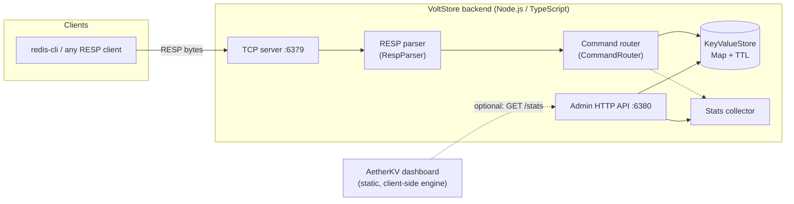

# VoltStore

[](https://github.com/abdullahwaseem-dev/voltstore-redis-clone/actions/workflows/ci.yml)
[](https://github.com/abdullahwaseem-dev/voltstore-redis-clone/actions/workflows/deploy-pages.yml)
[](LICENSE)
[](https://www.typescriptlang.org/)
[](https://nodejs.org/)

**A Redis-compatible in-memory data store, built from first principles — a hand-rolled RESP protocol parser, a concurrent TCP server, a lock-free storage engine, a telemetry API, and a companion control-center dashboard called AetherKV.**

No `redis` npm package, no protocol library. Every byte on the wire is parsed by code in this repo. It's a systems-programming portfolio piece: the goal is to demonstrate the mechanics real key-value stores are built on, not to compete with Redis itself.

**Live dashboard demo: [abdullahwaseem-dev.github.io/voltstore-redis-clone](https://abdullahwaseem-dev.github.io/voltstore-redis-clone/)** — no install required, runs entirely client-side. (Deploys automatically from `web/` via GitHub Actions — see the badge above; it may take a minute or two to go live after the first push.)

If you find this useful or interesting, a ⭐ on the repo is appreciated — it lets me know the project was useful.

---

## Table of contents

- [Overview](#overview)
- [Architecture](#architecture)
- [Tech stack & engineering trade-offs](#tech-stack--engineering-trade-offs)
- [Commands implemented](#commands-implemented)
- [Telemetry / admin API](#telemetry--admin-api)
- [AetherKV — the web dashboard](#aetherkv--the-web-dashboard)
- [Getting started](#getting-started)
- [Roadmap](#roadmap)

---

## Overview

VoltStore is a TCP server that speaks real [RESP](https://redis.io/docs/latest/develop/reference/protocol-spec/) (REdis Serialization Protocol), so you can explore the implemented commands with `redis-cli`. It implements a small command subset, not full Redis compatibility. Under the hood it implements, from scratch:

- A **streaming RESP parser** that reassembles commands from arbitrarily-fragmented TCP packets.
- A **thread-safe-by-construction in-memory store** with per-key TTL expiration.
- A **command router** dispatching `PING` / `SET` / `GET` / `DEL`, with Redis-compatible error semantics.
- A **telemetry/admin API** exposing live connection, memory, throughput, and cache hit-ratio metrics as JSON.
- **AetherKV**, a self-contained cyber-industrial dashboard that showcases the whole system through an interactive terminal and a live keyspace explorer.

The backend is written in TypeScript on Node.js; the dashboard is a single dependency-free HTML file. Both are described in full below.

---

## Architecture



### Request lifecycle

A `SET foo bar EX 10` sent by a client travels through four layers before a reply goes back:

1. **TCP socket layer** (`src/server.ts`) — `net.createServer` accepts the connection, opens a per-socket `RespParser`, and streams raw bytes from the `data` event into it as they arrive.
2. **RESP parser** (`src/resp/parser.ts`) — buffers those bytes until a complete `*<n>\r\n$<len>\r\n...` frame is available, then hands back `["SET", "foo", "bar", "EX", "10"]`. Malformed input (bad type byte, non-numeric length, missing CRLF) throws immediately as a protocol error.
3. **Command router** (`src/commands/router.ts`) — looks up `SET` in the handler table, validates arity, and delegates to `src/commands/handlers/set.ts`.
4. **Storage engine** (`src/store/store.ts`) — the handler calls `store.set("foo", "bar", 10)`, which stores the value with an absolute expiry timestamp in a `Map`.

The reply is RESP-encoded (`src/resp/encoder.ts`) and written back to the same socket. The `Stats` collector (`src/stats/stats.ts`) is incremented alongside step 3, and the admin HTTP server (`src/admin/adminServer.ts`) reads the same `store`/`stats` instances to serve `GET /stats` on a second port.

### Module breakdown

```
src/
  index.ts                  entry point: wires store + stats into both servers, starts listening
  server.ts                 TCP server; binds a RespParser + CommandRouter to each socket
  resp/
    parser.ts                incremental RESP parser (arrays of bulk strings)
    encoder.ts                encodes replies (simple string / error / integer / bulk string)
    errors.ts                 RespProtocolError (fatal, closes the connection) vs CommandError (per-command)
  store/
    store.ts                  KeyValueStore — the in-memory map, TTL logic, and stats() for telemetry
  stats/
    stats.ts                   Stats — connection / command / cache hit-miss counters
  admin/
    adminServer.ts              HTTP admin API — GET /stats returns live JSON metrics
  commands/
    router.ts                  looks up a command name and invokes its handler
    types.ts                    CommandHandler type
    handlers/                    one file per command (ping, set, get, del)
web/
  index.html                 AetherKV — the self-contained dashboard (see below)
```

### Concurrency model

Node.js runs application code on a single thread with an event loop; a command handler always runs to completion synchronously before the next one is dispatched, so two commands can never interleave mid-mutation. That makes the shared `KeyValueStore` **safe to access from every client connection with zero locks, mutexes, or atomics** — the concurrency safety comes from the runtime's execution model, not from defensive code. Each connection gets its own `RespParser` instance for per-socket buffering state, but all connections share one `KeyValueStore`, one `Stats` collector, and one `CommandRouter`.

### Protocol error handling

Two distinct failure modes are handled deliberately differently, mirroring real Redis:

- **Protocol violations** (`RespProtocolError`) — a bad type byte, an out-of-range or non-numeric length, a missing CRLF terminator. These corrupt the parser's position in the byte stream, so there's no safe way to keep reading; the server sends a RESP error and **closes the connection**.
- **Command errors** (`CommandError`) — wrong arity, an unknown command name, an invalid `EX` value. The byte stream itself was well-formed, so the connection stays open and the client just gets a RESP error reply and can keep going.

---

## Tech stack & engineering trade-offs

| Layer | Choice | Why | Trade-off accepted |
|---|---|---|---|
| Runtime | Node.js + TypeScript | The single-threaded event loop turns "thread-safe storage" into a free property of the execution model rather than something to hand-implement with locks; TypeScript gives compile-time protocol/type safety across the RESP layer. | Can't parallelize CPU-bound work across cores without `worker_threads`/`cluster`, which would reintroduce the shared-state coordination problem the single-thread model currently avoids for free. |
| Protocol | Hand-rolled RESP parser/encoder, no library | Full control over partial-frame buffering and error semantics; demonstrates the protocol-level engineering the project exists to showcase. | More code to write and test than `npm install redis-parser`. |
| Storage | Native `Map` with lazy TTL eviction | O(1) get/set/delete; zero external dependencies; expired keys are evicted the moment they're touched, so no background timer competes with request handling. | No persistence — the dataset is gone on process restart (tracked in [Roadmap](#roadmap)); lazy-only eviction means a key nobody reads again stays in memory past its expiry until the periodic `stats()` sweep or an admin poll passes over it. |
| Telemetry transport | Separate HTTP admin API (port 6380) instead of a custom RESP `INFO`-style command | JSON-over-HTTP is what a browser dashboard speaks natively — `fetch()`, no RESP client needed client-side — and keeps the RESP port itself protocol-pure. | A second listening socket to run and secure, instead of one. |
| Dashboard | Single static HTML file with a client-side command engine, not a frontend wired live to the backend | Zero build step, zero runtime dependency on the Node process — it's deployable to any static host (GitHub Pages included) and interactive the instant it loads, which matters for a portfolio piece a reviewer might open without ever running `npm install`. | The dashboard's telemetry is a faithful *simulation* of the backend's behavior (same command semantics, same TTL math), not literally the numbers from a running VoltStore process — the UI says so explicitly rather than implying a live link that doesn't exist. |

---

## Commands implemented

| Command | Behavior |
|---|---|
| `PING [message]` | Replies `PONG`, or echoes `message` if given |
| `SET key value [EX seconds]` | Stores the value; `EX` sets an expiry in seconds |
| `GET key` | Returns the value, or nil if missing/expired |
| `DEL key [key ...]` | Deletes given keys, returns the number actually removed |

Expiration is lazy: an expired key is treated as absent (and evicted) the next time it's looked up, rather than swept on a fixed timer.

---

## Telemetry / admin API

Alongside the RESP port, the server runs a small read-only HTTP admin API (`src/admin/adminServer.ts`) meant for a monitoring UI to poll — a plain `GET /stats` returning JSON, no RESP client needed in the browser.

- **Active connections** — live count of open TCP sockets.
- **Total keys / memory estimate** — `KeyValueStore.stats()` walks the map (evicting anything expired along the way) and sums each entry's key+value byte length plus a fixed per-entry overhead, alongside `process.memoryUsage()`'s RSS/heap figures for whole-process context.
- **Commands processed** — incremented once per recognized command dispatch.
- **GET hit/miss ratio** — recorded by the `GET` handler itself, the one place that already knows whether a lookup found a live key.

```bash
curl http://localhost:6380/stats
```

```json
{
  "timestamp": "2026-08-30T12:11:18.433Z",
  "connections": { "active": 2 },
  "keys": { "total": 1 },
  "memory": {
    "estimatedDatasetBytes": 53,
    "processRssBytes": 40001536,
    "processHeapUsedBytes": 5131592
  },
  "commands": { "totalProcessed": 8 },
  "get": { "hits": 2, "misses": 3, "hitRatio": 0.4 }
}
```

CORS is wide open (`Access-Control-Allow-Origin: *`) so a local dashboard on a different port can fetch it directly. There is no authentication — if this were ever exposed beyond localhost, it would need one first.

---

## AetherKV — the web dashboard

AetherKV (`web/index.html`) is a single self-contained page — no build step, no framework, no external JS dependency beyond two Google Fonts. It's meant to be the piece a portfolio visitor actually plays with.

### Wireframe

```
┌────────────────────────────────────────────────────────────────────────┐
│ ⌁ AetherKV          in-memory data engine · control center             │
│                                          ● ENGINE ONLINE     14:02:07   │
├────────────────────────────────────────────────────────────────────────┤
│ ┌────────────┐ ┌────────────┐ ┌────────────┐ ┌────────────┐            │
│ │ CONNECTIONS│ │   MEMORY   │ │ THROUGHPUT │ │  KEYSPACE  │            │
│ │     7      │ │  41.2 MB   │ │    3.4     │ │     12     │            │
│ │ ●●●●●●●○○○ │ │ ▓▓░░░░░░░░ │ │ ▂▃▅▇▅▃▂▁▂▃ │ │ 3 with TTL │            │
│ └────────────┘ └────────────┘ └────────────┘ └────────────┘            │
├────────────────────────────────┬─────────────────────────────────────  │
│ // RESP TERMINAL                │ // KEYSPACE EXPLORER                 │
│  aetherkv:6379> SET foo bar     │  KEY            VALUE       TTL      │
│  OK                             │  session:9f2a   operator…  2m 41s    │
│  → +OK\r\n                      │  deploy:region  us-east-1  ∞         │
│  aetherkv:6379> GET foo         │  node:role      primary    ∞         │
│  "bar"                          │  cache:warmup   1          12s   ✕   │
│  → $3\r\nbar\r\n                │                                     │
├─[PING][SET][GET][DEL][HELP]────┴─────────────────────────────────────  │
│ VoltStore backend · RESP protocol · TypeScript + Node.js                │
└────────────────────────────────────────────────────────────────────────┘
```

*(No real screenshot is checked into the repo yet — after running the dashboard locally, drop a PNG/GIF into `docs/` and link it here, e.g. ``.)*

### Visual language

- **Palette** — an obsidian ground (`#07080d`) rather than pure black, with two restrained accent colors: signal cyan (`#37e0c9`) for primary telemetry and successful replies, reactor violet (`#8f7bff`) for secondary structure, and a coral red (`#ff5d73`) reserved exclusively for errors.
- **Type** — [Chakra Petch](https://fonts.google.com/specimen/Chakra+Petch) for headings and labels (an angular, HUD-adjacent geometric sans), [JetBrains Mono](https://fonts.google.com/specimen/JetBrains+Mono) for every number, table cell, and terminal line — chosen for its tabular figures and unambiguous zero/one glyphs, since this is a page people read live numbers off of.
- **Structure** — every panel is framed with hairline corner brackets instead of a rounded card, evoking instrument housing rather than a marketing tile; a faint blueprint grid and a slow scanline sweep sit behind everything at low opacity.
- **Motion** — a scripted boot log types out in the terminal on load ("RESP command router … ready", "keyspace store … ready", …); metric digits flash briefly on change; a TTL cell pulses red once it's under 5 seconds from expiry. Motion is restrained elsewhere and respects `prefers-reduced-motion`.

### What it actually does

The dashboard runs a **client-side port of the real command engine** — its `SimStore` and command handlers are line-for-line equivalents of `src/store/store.ts` and `src/commands/handlers/*.ts` (same `SET`/`GET`/`DEL`/`PING` semantics, same arity and `EX` validation, same lazy-TTL eviction). Typing a command in the terminal:

1. Tokenizes the input line (quote-aware, like `redis-cli`).
2. Runs it through the same validation/dispatch logic as the real backend.
3. Prints a colored, badge-tagged reply (`OK` / `ERR` / `INT` / `STR` / `NIL`) plus the literal RESP wire frame underneath (e.g. `→ $3\r\nbar\r\n`).
4. Updates the four telemetry cards and the keyspace table immediately.

The keyspace persists to `localStorage` so a returning visitor's data survives a reload; the ambient jitter on the connections/memory/throughput cards is clearly simulated (and labeled as such in the footer) rather than pretending to be a live socket to a server that, in a hosted demo, isn't even running.

---

## Getting started

### Prerequisites

- Node.js ≥ 18
- npm
- (optional) `redis-cli` or Docker, for testing against the RESP port

### 1. Install and build

```bash
git clone https://github.com/abdullahwaseem-dev/voltstore-redis-clone.git
cd voltstore-redis-clone
npm install
npm run build
```

### 2. Run the backend

```bash
npm start
# or, for development with auto-reload on file changes:
npm run dev
```

You should see:

```
VoltStore listening on port 6379
VoltStore admin/metrics API listening on http://localhost:6380/stats
```

The RESP port defaults to `6379` (override with `PORT=<n>`); the admin API defaults to `6380` (override with `ADMIN_PORT=<n>`).

### 3. Connect with redis-cli

Use `redis-cli` to try the supported commands. If `redis-cli` isn't installed locally, run it via Docker instead of installing Redis:

```bash
docker run -it --rm --network host redis redis-cli -p 6379
```

(On Windows/Mac, `--network host` doesn't apply the same way — use `docker run -it --rm redis redis-cli -h host.docker.internal -p 6379` instead, or install `redis-cli` via WSL/Homebrew.)

```
127.0.0.1:6379> PING
PONG
127.0.0.1:6379> SET session abc123 EX 5
OK
127.0.0.1:6379> GET session
"abc123"
(wait 5+ seconds)
127.0.0.1:6379> GET session
(nil)
127.0.0.1:6379> DEL session missing
(integer) 0
127.0.0.1:6379> NOTACOMMAND
(error) ERR unknown command 'NOTACOMMAND'
```

Client-library compatibility is not guaranteed. Libraries can issue handshake, authentication, or metadata commands that VoltStore does not implement. Validate your client's startup behaviour and restrict experiments to the documented command subset.

### 4. Query live telemetry

```bash
curl http://localhost:6380/stats
```

### 5. Launch the AetherKV dashboard

No build step — it's a static file. Open it directly:

```bash
# Windows
start web/index.html
# macOS
open web/index.html
# Linux
xdg-open web/index.html
```

...or serve it with any static file server (`npx serve web`), or just try the [live demo](https://abdullahwaseem-dev.github.io/voltstore-redis-clone/) — it doesn't require the backend to be running at all, since it runs its own client-side engine (see [Tech stack & trade-offs](#tech-stack--engineering-trade-offs)).

---

## Roadmap

Ideas for extending VoltStore beyond the current scope, roughly in the order they'd naturally build on each other:

- **RDB-style snapshot persistence** — periodic point-in-time dump of the keyspace to disk, loaded back on startup, so data survives a restart.
- **Append-only file (AOF) durability** — log every write command to disk for stronger durability than periodic snapshots.
- **Active expiration cycle** — a periodic background sweep (in addition to today's lazy, access-triggered eviction) so idle expired keys don't linger in memory.
- **Additional data types** — Lists, Hashes, Sets, and Sorted Sets, each with their own command family (`LPUSH`/`LRANGE`, `HSET`/`HGET`, `SADD`/`SMEMBERS`, `ZADD`/`ZRANGE`).
- **Standalone TTL commands** — `EXPIRE`, `TTL`, `PERSIST` as first-class commands, rather than TTL only being settable via `SET ... EX`.
- **Pub/Sub channels** — `SUBSCRIBE` / `PUBLISH` / `UNSUBSCRIBE`, likely the biggest architectural addition since it requires pushing unsolicited messages to idle client sockets.
- **AUTH / access control** — a password-gated `AUTH` command before the admin API or RESP port would be safe to expose beyond localhost.
- **Replication** — a minimal leader-follower setup, propagating writes to replicas.
- **A live mode for AetherKV** — a toggle that points the dashboard at a real, running backend's `GET /stats` (and a WebSocket or SSE push instead of poll-based updates) when it's self-hosted outside a sandboxed environment, alongside the current fully-offline simulated mode.
- **Automated test suite** — unit tests for the RESP parser's edge cases and command handlers, plus integration tests that drive the TCP server directly. CI (`.github/workflows/ci.yml`) currently only type-checks and builds; there's nothing to run yet.

---

## Contributing

Start with the [contribution guide](CONTRIBUTING.md) for local checks, focused pull requests, and useful bug reports. The highest-priority improvement is an automated test suite for fragmented RESP frames, command errors, and TTL expiry.

## License

[MIT](LICENSE) © Muhammad Abdullah Waseem
